<h1 align="center">Hi 👋, I'm <b>Nour Yahyaoui</b></h1>

  <b>Full-Stack Developer</b> · Tunisia · 3+ years freelance · <b>Rust</b> · <b>Next.js</b> · <b>React Native</b> · <b>Ollama</b> · <b>Qwen</b> · <b>Supabase</b>

  <i>"AI power with the perfect leadership"</i>

  
  &nbsp;
  

📑 Table of Contents

- [About Me](#-about-me)
- [GitHub Stats & Rankings](#-github-stats--rankings)
- [Featured Projects](#-featured-projects)
- [Tech Stack](#-tech-stack)
- [Connect](#-connect)

---

## 👨‍💻 About Me

I'm **Nour Yahyaoui**, a 19-year-old full-stack developer from **Tunisia** with **3+ years of freelance and client experience**. I build beautiful, secure, and scalable applications — from web and mobile to desktop — turning complex problems into elegant solutions.

**My journey:** I started with Python and web fundamentals, moved through JavaScript, React, and modern full-stack development with Next.js, React Native, and serverless architectures. Today I'm expanding into **Rust (Actix Web / Axum & native systems)** to build performance-critical backend services and desktop software.

**What I build:** production web apps end-to-end (frontend, backend, deployment), plus my own tooling from scratch — including **RustPad** (zero-dependency Rust desktop studio), **nour-code** (local AI coding agent on Ollama), **Matjari** (POS system for retail shops), and more.

📌 Each project below links to its own dedicated README with the full story, features, and setup.

---

## 📊 GitHub Stats & Rankings

<!-- stats.svg and top-langs.svg are rendered from live GitHub data by .github/workflows/update-stats.yml and committed here. -->

  
  

  
  

  

*Stats cards are regenerated weekly from live GitHub data via GitHub Actions and committed locally — no external hotlinks that can pause or 503.*

---

## 🚀 Featured Projects

| Project | What it is | Stack | Full README |
|---------|-----------|-------|-------------|
| 🦀 **RustPad** | Native desktop Word (`.docx`) & vector PDF (`.pdf`) studio — 4.96 MB, zero `crates.io` deps | Rust, Win32/X11 | [Read full →](projects/rustpad/README.md) |
| 🖥️ **VexOS Desktop** | Live Linux desktop (Debian) with browser-based IDE, Run button, live preview, AI assistant | Debian, XFCE, Rust, Python, Node | [Read full →](projects/vexos/README.md) |
| 🤖 **nour-code** | Local AI coding agent — Qwen3 8B on Ollama, FastAPI, permission-checked tool access | Python, FastAPI, Ollama, Qwen | [Read full →](projects/nour-code/README.md) |
| 🛒 **Matjari** | Full POS system for small/medium shops — sales, stock, orders, debts, employees | React, Vite, JavaScript | [Read full →](projects/matjari/README.md) |
| 🧩 **Grafspee** | 60+ production-ready React/Next.js components — copy-paste, customize, build faster | Next.js, React, TypeScript, Tailwind | [Read full →](projects/grafspee/README.md) |
| 🛡️ **env-sentry** | Zero-dependency Python CLI — catches `.env` drift, leaked secrets, missing `.gitignore` entries | Python | [Read full →](projects/env-sentry/README.md) |

---

## 🧰 Tech Stack

### 🖥️ Frontend
*Building responsive, interactive UIs with modern frameworks*

### ⚙️ Backend
*Scalable serverless APIs and database architecture*

### 🤖 AI & Agents
*Local inference, tool-using agents and the guardrails around them*

### 📱 Mobile
*Native and cross-platform mobile applications*

---

## 📫 Connect

  
  &nbsp;
  

---

  <i>Thanks for visiting my profile! 🚀</i>

