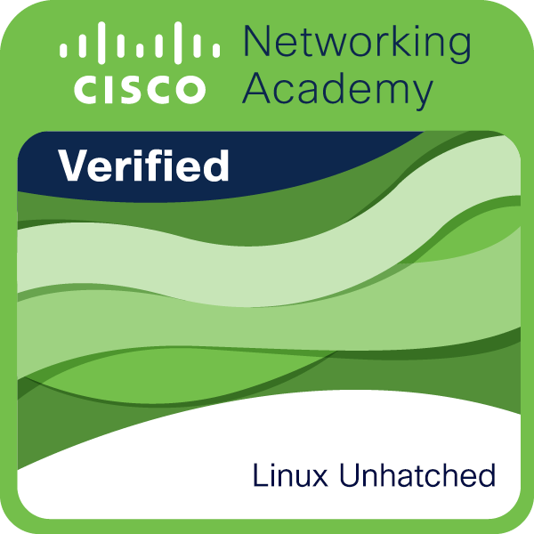

<h1 align="center">Nour Yahyaoui</h1>

  Full-stack developer from Tunisia · Rust (Actix Web) · Next.js · PostgreSQL
   
  3 years of freelance and client work · Open to freelance and collaboration

  <a href="https://nour-yahyaoui.vercel.app">Portfolio</a> ·
  <a href="https://www.linkedin.com/in/nour-yahyaoui-86987b36b">LinkedIn</a> ·
  <a href="https://agencyos-web-beryl.vercel.app">AgencyOS demo</a>

---

## About

I build web, desktop and tooling projects end to end: frontend, backend, database and deployment. I started with Python and the web, moved through React, Next.js and serverless, and now go deeper into **Rust** for fast, secure backends and native software.

**Right now:** writing production-grade Actix Web servers (REST routes, auth, rate limiting, caching) and shipping side projects in public.

---

## Featured projects

| Project | What it does | Stack |
| --- | --- | --- |
| [**RustPad**](https://github.com/Nour-yahyaoui/rustpad) | Native desktop Word (`.docx`) and vector PDF studio. Single 4.96 MB executable, zero `crates.io` dependencies. | Rust, Win32/X11 |
| [**AgencyOS**](https://github.com/Nour-yahyaoui/agencyos) | Multi-tenant platform for agencies: clients, Kanban delivery, scoped client portal, support, documents, Stripe billing. | Next.js, NestJS, PostgreSQL, Prisma |
| [**nour-code**](https://github.com/Nour-yahyaoui/nour-code) | Local AI coding agent running Qwen3 8B on Ollama, with permission-checked tool access. | Python, FastAPI, Ollama |
| [**VexOS**](https://github.com/Nour-yahyaoui/vexos) | Live Debian-based Linux desktop with a browser IDE, run button, live preview and AI assistant. | Debian, XFCE, Rust, Node |
| [**Matjari**](https://github.com/Nour-yahyaoui/matjari-web) | Point of sale and inventory system for small shops: sales, stock, orders, debts, employees. | React, Vite |

---

## Published packages

| Package | Install | What it does |
| --- | --- | --- |
| [**env-sentry**](https://pypi.org/project/env-sentry/) | `pip install env-sentry` | Zero-dependency CLI that catches `.env` drift, leaked secrets and missing `.gitignore` entries. |
| [**rusturbo**](https://www.npmjs.com/package/rusturbo) | `npm i -g rusturbo` | Rust compilation accelerator: reuses build artifacts, drives `mold`/`lld` + `sccache`, benchmarks real builds. |
| [**bidi-kit**](https://www.npmjs.com/package/bidi-kit) | `npm i bidi-kit` | Zero-dependency toolkit for mixing Arabic/RTL and Latin/LTR text cleanly in TypeScript/JS. |

---

## Tech stack

**Languages:** Rust · TypeScript · JavaScript · Python
**Frontend:** React · Next.js · Tailwind CSS · React Native (Expo)
**Backend:** Actix Web · NestJS · Node.js · FastAPI · REST · WebSocket
**Data:** PostgreSQL · Prisma · Neon · Redis
**Tools:** Git · Docker · Vercel · Render · Ollama

---

## Stats

  
  

---

  Let's build something. <a href="https://nour-yahyaoui.vercel.app">Get in touch →</a>

st](https://img.shields.io/badge/Rust-000000?style=for-the-badge&logo=rust&logoColor=white)

### 🤖 AI & Agents
*Local inference, tool-using agents and the guardrails around them*

### 📱 Mobile
*Native and cross-platform mobile applications*

---

## 🎓 Certifications

|  | **Linux Unhatched** Statement of Achievement · student level credential | Cisco Networking Academy in collaboration with NDG | Nov 2026 | [PDF ⧉](certificates/linux-unhatched.pdf) |
|:--:|---|---|---:|:--:|

Covered: the Linux command line, filesystem navigation, creating and moving files, searching and extracting data, writing simple scripts, file permissions and ownership, user management, and querying network configuration.

---

## 📊 GitHub Stats

  
  

  
  

  

Stats and language cards are rendered from live GitHub data by GitHub Actions and committed to this repo, so they cannot break the way a third-party card service can.

---

## 📫 Connect

  
  
  

  <i>Thanks for visiting — open to freelance work and collaboration. 🚀</i>

