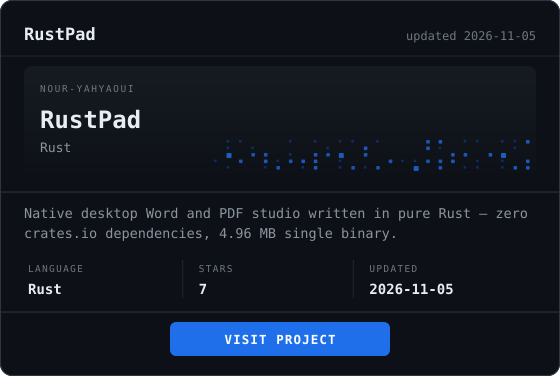
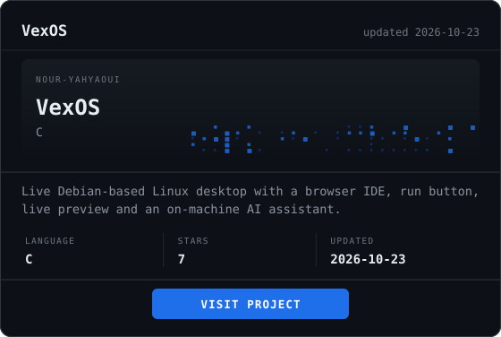
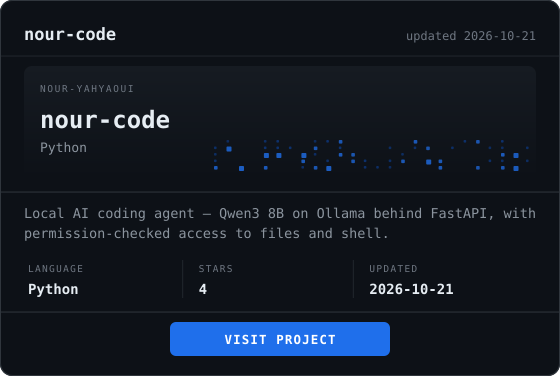
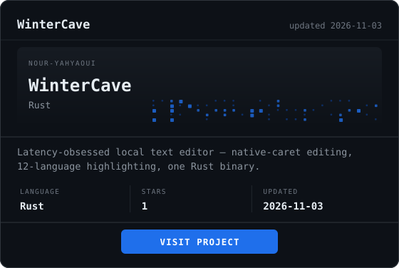
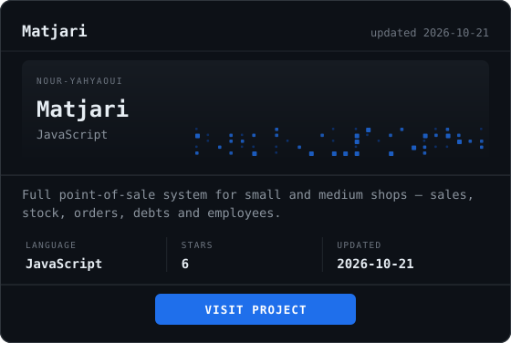
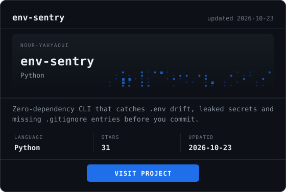
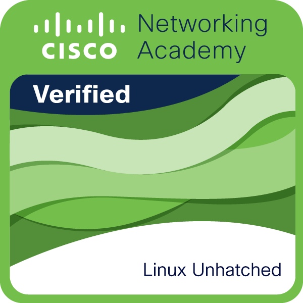

<h1>Hiiiii 👋, I'm Nour Yahyaoui</h1>

  <b>Full-stack developer</b> &nbsp;·&nbsp; Tunisia &nbsp;·&nbsp; 3+ years freelance

  Rust &nbsp;·&nbsp; Next.js &nbsp;·&nbsp; React Native &nbsp;·&nbsp; Ollama &nbsp;·&nbsp; Qwen &nbsp;·&nbsp; Supabase

<table align="center" width="100%">
  <tr>
    <td align="center" width="50%">
      
    </td>
    <td align="center" width="50%">
      
    </td>
  </tr>
</table>

  
  
  

  
  

---

## 👨‍💻 About Me

> *"AI power with the perfect leadership."*

🎓 I'm a **19-year-old full-stack developer from Tunisia** with **3 years of freelance and client experience**. I craft beautiful, secure and scalable applications — from web and mobile to desktop — turning complex problems into elegant solutions.

I started with Python and web fundamentals, then moved through JavaScript, React, Next.js, React Native and serverless architectures. Today I build production apps end to end — frontend, backend and deployment — and I'm going deeper into **Rust (Actix Web / Axum and native systems)** for performance-critical services and desktop software.

**Lately that means building my own tooling from scratch:**

- 🦀 **RustPad** — a zero-dependency pure-Rust desktop Word & PDF studio, compiled to a single 4.96 MB executable
- ❄️ **WinterCave** — a latency-obsessed local text editor: one Rust binary, native caret, 12-language highlighting
- 🤖 **nour-code** — a local AI coding agent running Qwen3 8B on Ollama, with permission-checked access to real tools

📌 The pinned repos below are the real signal — what I actually build beats any project count.

---

## 🚀 Featured Projects

  Each card links to its repository. Themes follow your light/dark preference.

  <a href="https://github.com/Nour-yahyaoui/rustpad">
    <picture>
      <source media="(prefers-color-scheme: dark)" srcset=".github/assets/cards/rustpad-dark.svg" />
      <source media="(prefers-color-scheme: light)" srcset=".github/assets/cards/rustpad-light.svg" />
      
    </picture>
  </a>
  <a href="https://github.com/Nour-yahyaoui/vexos">
    <picture>
      <source media="(prefers-color-scheme: dark)" srcset=".github/assets/cards/vexos-dark.svg" />
      <source media="(prefers-color-scheme: light)" srcset=".github/assets/cards/vexos-light.svg" />
      
    </picture>
  </a>

  <a href="https://github.com/Nour-yahyaoui/nour-code">
    <picture>
      <source media="(prefers-color-scheme: dark)" srcset=".github/assets/cards/nour-code-dark.svg" />
      <source media="(prefers-color-scheme: light)" srcset=".github/assets/cards/nour-code-light.svg" />
      
    </picture>
  </a>
  <a href="https://github.com/Nour-yahyaoui/WinterCave">
    <picture>
      <source media="(prefers-color-scheme: dark)" srcset=".github/assets/cards/wintercave-dark.svg" />
      <source media="(prefers-color-scheme: light)" srcset=".github/assets/cards/wintercave-light.svg" />
      
    </picture>
  </a>

  <a href="https://github.com/Nour-yahyaoui/matjari-web">
    <picture>
      <source media="(prefers-color-scheme: dark)" srcset=".github/assets/cards/matjari-dark.svg" />
      <source media="(prefers-color-scheme: light)" srcset=".github/assets/cards/matjari-light.svg" />
      
    </picture>
  </a>
  <a href="https://github.com/Nour-yahyaoui/env-sentry">
    <picture>
      <source media="(prefers-color-scheme: dark)" srcset=".github/assets/cards/env-sentry-dark.svg" />
      <source media="(prefers-color-scheme: light)" srcset=".github/assets/cards/env-sentry-light.svg" />
      
    </picture>
  </a>

📋 Prefer plain text? Same projects as a table

| Project | What it is | Stack | Full README |
|---------|-----------|-------|-------------|
| 🦀 **RustPad** | Native desktop Word (`.docx`) & vector PDF (`.pdf`) studio — 4.96 MB, zero `crates.io` deps | Rust, Win32/X11 | [Read full →](projects/rustpad/README.md) |
| 🖥️ **VexOS Desktop** | Live Linux desktop (Debian) with browser-based IDE, Run button, live preview, AI assistant | Debian, XFCE, Rust, Python, Node | [Read full →](projects/vexos/README.md) |
| 🤖 **nour-code** | Local AI coding agent — Qwen3 8B on Ollama, FastAPI, permission-checked tool access | Python, FastAPI, Ollama, Qwen | [Read full →](projects/nour-code/README.md) |
| ❄️ **WinterCave** | Latency-obsessed local text editor — native-caret editing, 12-language highlighting, one Rust binary, no Node/npm | Rust, Actix Web, Vanilla JS | [Read full →](projects/wintercave/README.md) |
| 🛒 **Matjari** | Full POS system for small/medium shops — sales, stock, orders, debts, employees | React, Vite, JavaScript | [Read full →](projects/matjari/README.md) |
| 🛡️ **env-sentry** | Zero-dependency Python CLI — catches `.env` drift, leaked secrets, missing `.gitignore` entries | Python | [Read full →](projects/env-sentry/README.md) |

---

## 🧰 Tech Stack

#### 🖥️ Frontend
*Building responsive, interactive UIs with modern frameworks*

#### ⚙️ Backend
*Scalable serverless APIs and database architecture*

#### 🤖 AI & Agents
*Local inference, tool-using agents and the guardrails around them*

#### 📱 Mobile
*Native and cross-platform mobile applications*

---

## 🎓 Certifications

|  | **Linux Unhatched** Statement of Achievement · student level credential | Cisco Networking Academy in collaboration with NDG | Nov 2026 | [PDF ⧉](certificates/linux-unhatched.pdf) |
|:--:|---|---|---:|:--:|

Covered: the Linux command line, filesystem navigation, creating and moving files, searching and extracting data, writing simple scripts, file permissions and ownership, user management, and querying network configuration.

---

## 📊 GitHub Stats

  
  

  
  

  

Stats and language cards are rendered from live GitHub data by GitHub Actions and committed to this repo, so they cannot break the way a third-party card service can.

---

## 📫 Connect

  
  
  

  <i>Thanks for visiting — open to freelance work and collaboration. 🚀</i>

